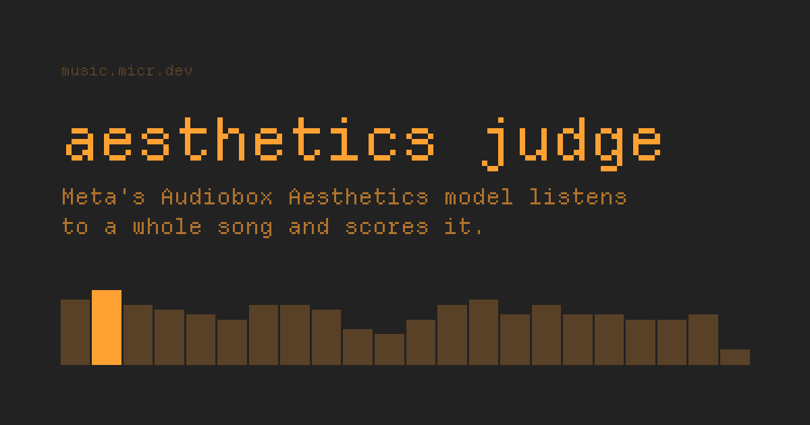

# aesthetics judge

Meta's [Audiobox Aesthetics](https://huggingface.co/facebook/audiobox-aesthetics) model listens to a whole song and scores it, in your browser.

**Live:** https://music.micr.dev



Drop in an audio file. The site decodes it, runs the model on every 10-second window on your device, works out which song it is, and gives you a score and a share card. Your audio never leaves the browser.

## Scores

| Axis | What it rates |
|---|---|
| Content enjoyment | how much a listener would enjoy it (the headline score) |
| Content usefulness | how useful it is as material for making things |
| Production complexity | how dense the audio is |
| Production quality | clarity, fidelity, dynamics |

All four are on a 1-10 scale, averaged over the whole track.

## How it works

```
audio file ──> Web Audio decode (16 kHz mono)
           ──> model worker: ONNX int8, onnxruntime-web (WASM, multithreaded) ──> scores
           ──> tags ──> iTunes + Deezer catalog match (title, artist, cover) ──> share card
           ──> public feed (Cloudflare Worker + D1)
```

- **Model:** an int8 ONNX export of Meta's checkpoint, hosted at [Microck/audiobox-aesthetics-onnx](https://huggingface.co/Microck/audiobox-aesthetics-onnx). It scores within 0.02 of the PyTorch original. `tools/export-onnx.py` reproduces it.
- **Song detection:** file tags are often junk (YouTube rips carry video titles and uploader names), so the site cleans them and confirms against iTunes and Deezer. It picks the result whose artist appears in the file and whose length matches. Untagged files can be identified by audio fingerprint through AcoustID.
- **Why upload instead of a Spotify link:** Spotify and YouTube don't let other sites download audio. You can point the site at your own download service in "fetcher" settings.

## Layout

| Path | What |
|---|---|
| `web/src` | the site (React, Vite, Tailwind, Base UI, motion) |
| `web/api` | the API Worker: public feed, AcoustID proxy, Deezer proxy, rate limits |
| `tools/` | model export and share-image scripts (Python, uv) |
| `docs/deploy.md` | running locally, deploying, rate limits |

## Run locally

```sh
cd web
bun install
uv run python ../tools/export-onnx.py   # writes web/public/models/aes.int8.onnx (~126 MB)
bun run db:local
bun run api    # API Worker on :8787
bun run dev    # site on :5173
```

## Credits

- Model: [Audiobox Aesthetics](https://github.com/facebookresearch/audiobox-aesthetics) by Meta, CC-BY 4.0 ([paper](https://arxiv.org/abs/2502.05139)).
- Font: [Departure Mono](https://departuremono.com) by Helena Zhang, SIL OFL.
- Catalog data: iTunes Search API, Deezer API, AcoustID, MusicBrainz, Cover Art Archive.

## Regression and browser tests

In `web/`, run `bun install --frozen-lockfile`, `bun run test`, `bun run build`,
`bunx e2e-web install chromium`, then `bun run test:e2e`.
The pinned tester-army/e2e suite is deterministic and makes no AI agent calls.
It uses a generated local WAV, simulated worker results/errors, and intercepted
catalog/feed responses. It does not publish to the real feed or establish model
accuracy. Separate unit tests cover AudioContext cleanup and download filenames.
